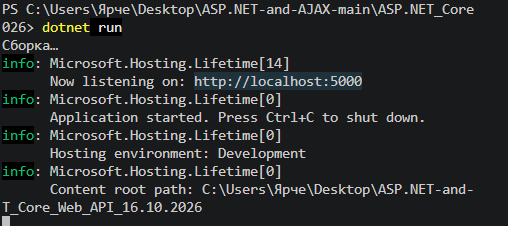
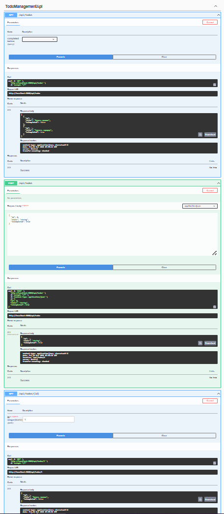
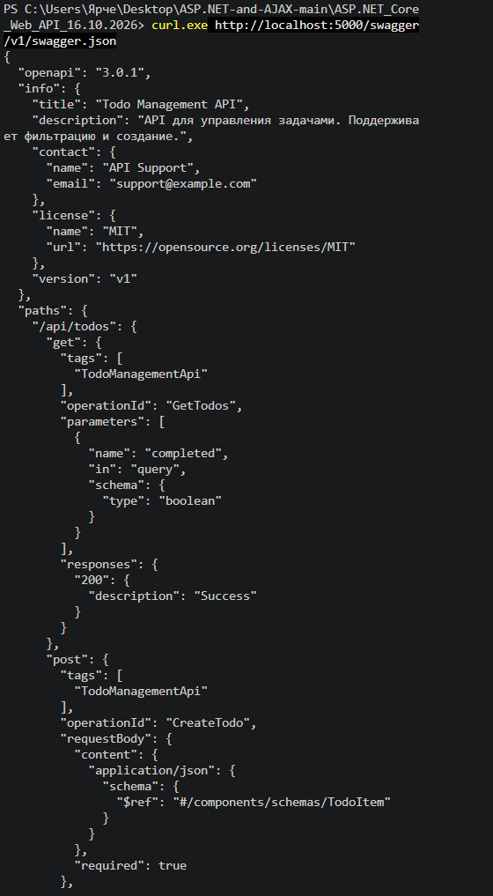

```markdown
# TodoManagementApi — настройка OpenAPI (Swagger) в ASP.NET Core

## Цель работы

Изучить настройку OpenAPI (Swagger) в ASP.NET Core и научиться задавать информацию об API через `OpenApiInfo`.

## Задание

Реализовать проект **Todo Management API** и настроить Swagger со следующими данными:

- **Title**: `"Todo Management API"`
- **Version**: `"v1"`
- **Description**: `"API для управления задачами. Поддерживает фильтрацию и создание."`
- **Contact**: `Name = "API Support"`, `Email = "support@example.com"`
- **License**: `Name = "MIT"`, `Url = "https://opensource.org/licenses/MIT"`

Дополнительно реализованы эндпоинты:

- `GET /api/todos` — получение списка задач;
- `GET /api/todos?completed=true` — фильтрация задач по статусу;
- `GET /api/todos/{id}` — получение задачи по идентификатору;
- `POST /api/todos` — создание новой задачи.

## Структура проекта

```text
TodoManagementApi/
├── Properties/
│   └── launchSettings.json
├── appsettings.json
├── appsettings.Development.json
├── Program.cs
├── TodoManagementApi.csproj
└── TodoManagementApi.http
```

> Папки `bin/` и `obj/` создаются автоматически при сборке.

## Ключевые файлы

### Program.cs

```csharp
using Microsoft.OpenApi.Models;

var builder = WebApplication.CreateBuilder(args);

builder.Services.AddEndpointsApiExplorer();

builder.Services.AddSwaggerGen(c =>
{
    c.SwaggerDoc("v1", new OpenApiInfo
    {
        Title = "Todo Management API",
        Version = "v1",
        Description = "API для управления задачами. Поддерживает фильтрацию и создание.",
        Contact = new OpenApiContact
        {
            Name = "API Support",
            Email = "support@example.com"
        },
        License = new OpenApiLicense
        {
            Name = "MIT",
            Url = new Uri("https://opensource.org/licenses/MIT")
        }
    });
});

var app = builder.Build();

if (app.Environment.IsDevelopment())
{
    app.UseSwagger();
    app.UseSwaggerUI(c =>
    {
        c.SwaggerEndpoint("/swagger/v1/swagger.json", "Todo Management API v1");
    });
}

var todos = new List<TodoItem>
{
    new(1, "Купить молоко", false),
    new(2, "Сделать зарядку", true)
};

app.MapGet("/api/todos", (bool? completed) =>
{
    var result = completed is null
        ? todos
        : todos.Where(t => t.IsCompleted == completed).ToList();

    return Results.Ok(result);
})
.WithName("GetTodos");

app.MapGet("/api/todos/{id:int}", (int id) =>
{
    var todo = todos.FirstOrDefault(t => t.Id == id);
    return todo is not null ? Results.Ok(todo) : Results.NotFound();
})
.WithName("GetTodoById");

app.MapPost("/api/todos", (TodoItem item) =>
{
    var newId = todos.Count == 0 ? 1 : todos.Max(t => t.Id) + 1;
    var newItem = item with { Id = newId };
    todos.Add(newItem);

    return Results.Created($"/api/todos/{newId}", newItem);
})
.WithName("CreateTodo");

app.Run();

record TodoItem(int Id, string Title, bool IsCompleted);
```

### TodoManagementApi.csproj

```xml
<Project Sdk="Microsoft.NET.Sdk.Web">
  <PropertyGroup>
    <TargetFramework>net8.0</TargetFramework>
    <Nullable>enable</Nullable>
    <ImplicitUsings>enable</ImplicitUsings>
  </PropertyGroup>

  <ItemGroup>
    <PackageReference Include="Swashbuckle.AspNetCore" Version="6.5.0" />
  </ItemGroup>
</Project>
```

### appsettings.json

```json
{
  "Logging": {
    "LogLevel": {
      "Default": "Information",
      "Microsoft.AspNetCore": "Warning"
    }
  },
  "AllowedHosts": "*"
}
```

### appsettings.Development.json

```json
{
  "Logging": {
    "LogLevel": {
      "Default": "Information",
      "Microsoft.AspNetCore": "Warning"
    }
  }
}
```

### Properties/launchSettings.json

```json
{
  "$schema": "http://json.schemastore.org/launchsettings.json",
  "iisSettings": {
    "windowsAuthentication": false,
    "anonymousAuthentication": true,
    "iisExpress": {
      "applicationUrl": "http://localhost:5000",
      "sslPort": 0
    }
  },
  "profiles": {
    "http": {
      "commandName": "Project",
      "dotnetRunMessages": true,
      "launchBrowser": true,
      "launchUrl": "swagger",
      "applicationUrl": "http://localhost:5000",
      "environmentVariables": {
        "ASPNETCORE_ENVIRONMENT": "Development"
      }
    },
    "IIS Express": {
      "commandName": "IISExpress",
      "launchBrowser": true,
      "launchUrl": "swagger",
      "environmentVariables": {
        "ASPNETCORE_ENVIRONMENT": "Development"
      }
    }
  }
}
```

## Запуск проекта

Открой терминал в папке, где находится `TodoManagementApi.csproj`, и выполни:

```powershell
dotnet restore
dotnet build
dotnet run --urls http://localhost:5000
```

После запуска приложение будет доступно по адресам:

- API: `http://localhost:5000`
- Swagger UI: `http://localhost:5000/swagger`
- OpenAPI-документ: `http://localhost:5000/swagger/v1/swagger.json`

## Скриншоты

### Скриншот 1 — запуск проекта в командной строке

На скриншоте должен быть виден терминал с выполненной командой `dotnet run --urls http://localhost:5000` и сообщением:

```text
Now listening on: http://localhost:5000
Application started. Press Ctrl+C to shut down.
```



*Рисунок 1 — Запуск проекта.*

### Скриншот 2 — страница Swagger UI

Открой в браузере `http://localhost:5000/swagger`. На скриншоте должны быть видны:

- заголовок **Todo Management API**;
- версия **v1**;
- описание **"API для управления задачами. Поддерживает фильтрацию и создание."**;
- список эндпоинтов `GET /api/todos`, `GET /api/todos/{id}`, `POST /api/todos`.



*Рисунок 2 — Настроенная документация Swagger.*

### Скриншот 3 — проверка OpenAPI-документа через командную строку

Выполни во втором терминале:

```powershell
curl.exe -i http://localhost:5000/swagger/v1/swagger.json
```

На скриншоте должны быть видны `200 OK` и блок `info` с полями `title`, `version`, `description`, `contact`, `license`.


*Рисунок 3 — Проверка OpenAPI-документа через командную строку.*

## Вывод

В ходе работы был создан проект **TodoManagementApi** на ASP.NET Core Minimal API. Подключён и настроен Swagger с использованием `OpenApiInfo`: заданы Title, Version, Description, Contact и License. Реализованы эндпоинты для получения, фильтрации и создания задач. Работа подтверждена скриншотами запуска, Swagger UI и ответа `swagger.json`.
